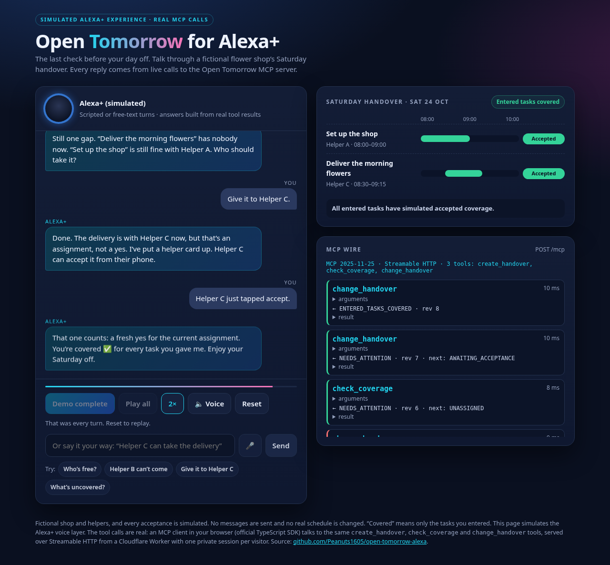
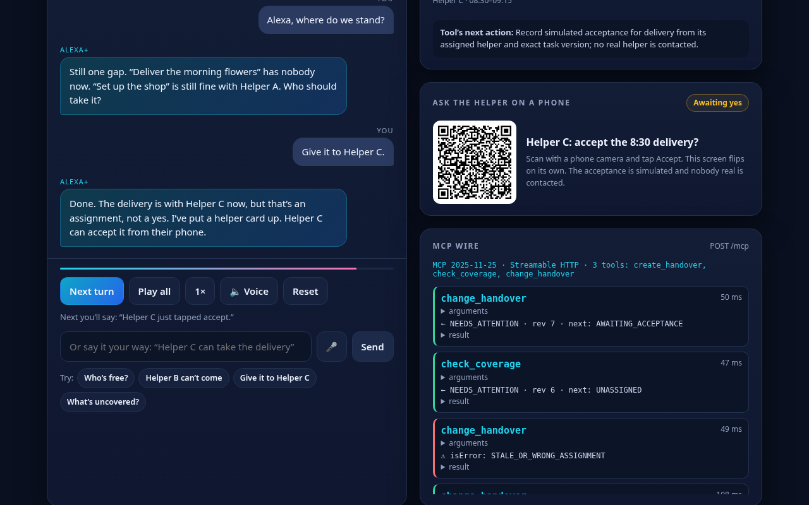
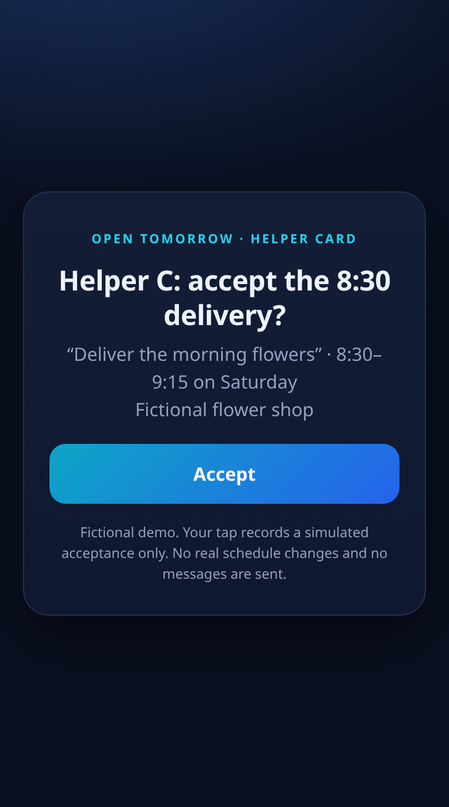
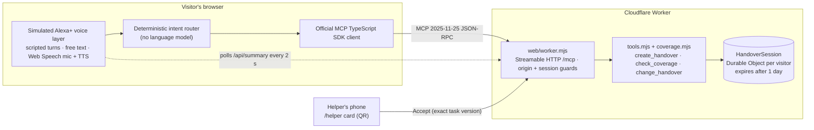

# Open Tomorrow for Alexa+

The last check before your day off, and it won't tell you you're covered when you're not.

Open Tomorrow is a **self-hosted MCP server** (protocol **2025-11-25**, Streamable HTTP) plus a **simulated Alexa+ experience** that calls it live. A small-business owner asks Alexa+ whether tomorrow is covered; Open Tomorrow checks the real handover: exact time clashes, who has actually *accepted* (not just been assigned), and whether a cancellation reopened a task. An old "yes" for a cancelled assignment never counts.

**Try it:** https://open-tomorrow-alexa.gigantic-stranger.workers.dev/ (Play all, type your own request, or scan the helper QR code with a phone to accept a task).

The shop, helpers and every acceptance are fictional and simulated. Nothing sends messages or changes anybody's real schedule.



## For judges: the 60-second path

1. Open the [live demo](https://open-tomorrow-alexa.gigantic-stranger.workers.dev/) and press **Play all** (2× for speed). Nine turns: a clash, a reassignment, two acceptances, a cancellation, then the key moment.
2. Watch the **MCP wire** panel when Helper B's old "yes" is replayed: the server answers `isError: STALE_OR_WRONG_ASSIGNMENT`. Acceptance is bound to the exact task version, so a yes for a cancelled assignment can't make the day look covered.
3. Press **Reset**, then type your own words ("who's free?", "Helper A can't come", "give it to Helper C").
4. When a task is waiting for a yes, scan the **helper QR** with a phone and tap **Accept**. The desktop board flips within about two seconds, through the same version-checked rules.
5. Locally: `npm ci --ignore-scripts && npm test && npm run demo`. No keys or accounts needed.

| Stale yes rejected, helper card offered | Helper card on a phone |
|---|---|
|  |  |

## Architecture



The same `tools.mjs`/`coverage.mjs` run under `npm start` (loopback Node server with a JSON file store) and in the Worker, so the proof in `npm run demo` and the live page exercise identical rules.

## What is real and what is simulated

| Part | Status |
|---|---|
| MCP server, tools, coverage rules, revision checks, idempotent `operationId`s | **Real**, running live and in tests |
| Browser MCP client (official SDK, Streamable HTTP, protocol negotiation) | **Real** |
| Per-visitor persistence (Durable Object) and the phone acceptance round trip | **Real** |
| Alexa+ voice layer (turn-taking, speech) | **Simulated** in the page; the tool calls it makes are real |
| Understanding free text | Deterministic keyword router, **no language model** |
| Helpers, shop and acceptances | **Fictional**; no messages sent, no real schedules |

## Why it matters

Small teams often hand over a day by group chat, where "assigned" quietly turns into "agreed" and a cancellation leaves a gap nobody re-checks. Open Tomorrow asks Alexa+ for one narrow, checkable promise: every task you entered has a current assignee who said yes to that exact version, with no clashes, and you confirmed the list is complete. Anything less, and it tells you what to fix next.

## Run the complete proof

Use Node 22+ and npm:

```sh
npm ci --ignore-scripts
npm test
npm run demo
```

No API key, AWS account, Amazon device, model service, payment, or sign-in is required. `demo` starts a server on an ephemeral loopback port, connects using the official MCP client over Streamable HTTP, discovers and calls the actual tools, restarts the server, and checks that state survived. Fixture state is saved to a uniquely named OS temporary directory; no user plan is overwritten.

The successful demonstration proves:

1. The exact 08:30–09:00 overlap blocks coverage.
2. Moving delivery to a second helper does not invent acceptance.
3. Simulated helper acceptance plus explicit entered-scope confirmation permits the narrowly scoped result, “All entered tasks have simulated accepted coverage.”
4. Cancelling the second helper reopens delivery while leaving setup and its acceptance intact.
5. Acceptance from the cancelled assignment is rejected.
6. The changed plan survives a process restart and a new MCP connection.

Each `check_coverage` result also returns one deterministic `nextAction`. Across all entered tasks, it puts assignment, availability or overlap ahead of simulated acceptance; after all entered tasks are accepted, it asks for an explicit entered-scope review. `nextAction` becomes `null` only when the narrowly scoped simulated handover is covered. This is guidance from entered facts, not a message to a real helper or a claim that omitted duties are safe.

## Simulated Alexa+ experience (web)

Live: **https://open-tomorrow-alexa.gigantic-stranger.workers.dev/**

A judge-facing page that simulates the Alexa+ voice layer. Scripted voice turns are shown, and optionally spoken with the browser's speech synthesis (with a 2× speed option). Visitors can also type, or speak where the browser supports the Web Speech API, their own requests ("who's free?", "Helper B can't come", "give it to Helper C", "what's uncovered?", "that's everything"). A deterministic intent router (no language model) maps those words onto the same MCP tool calls, shown live in the wire panel. When a task is waiting for a yes, a locally generated QR code opens a helper card on a phone; tapping Accept records a simulated acceptance for the exact current assignment through the same rules, and the main screen flips to covered. Every Alexa+ reply is built from live MCP tool results. The browser runs the official MCP TypeScript SDK client. It talks over Streamable HTTP (2025-11-25) to the same `create_handover`, `check_coverage` and `change_handover` tools (`tools.mjs`, `coverage.mjs`), served by a Cloudflare Worker (`web/worker.mjs`). Each visitor gets a private Durable Object session that expires after a day. The voice layer is simulated; the tool calls are not.

```sh
npm ci
node web/build.mjs          # bundles the browser client and the Worker into dist/
npx wrangler dev            # local Worker on http://127.0.0.1:8787 (wrangler needs Node 22+)
node web/smoke.mjs http://127.0.0.1:8787   # end-to-end MCP check against a local or deployed Worker
npx wrangler deploy         # deploy (uses wrangler.toml)
```

## MCP surface

`npm start` serves `http://127.0.0.1:8917/mcp` and stores its single local plan in `.local/plan.json`. Compatible agent clients can call:

- `create_handover`: initialize explicit dated tasks and helper availability once.
- `check_coverage`: read exact blockers, the first safe next action, entered-scope status and last affected tasks.
- `change_handover`: version-checked assignment, simulated acceptance, cancellation, time correction, or scope confirmation.

Protocol **2025-11-25**, negotiated and verified in the demonstration using `@modelcontextprotocol/sdk` 1.30.0. This is not a wrapper claiming integration only in documentation: the actual client/server transport and tools run in the proof.

## Deliberate boundaries

- All acceptance is a **simulated helper action**, not identity-authenticated consent. A production acceptance flow is not implemented.
- The result covers **entered tasks only**. Missing duties are unknown, not safe. This is not labor-law, staffing, travel-time, safety or business-continuity advice.
- One day, explicit local wall-time minutes, one operator/server process. Multiple processes sharing a store are unsupported. No shift import, optimization, real-time integrations, employee messaging or automatic plan completion is claimed.
- The local development server (`npm start`) is loopback only and rejects browser origins. Do not expose it to the network: authentication, multi-user isolation and public hosting are not implemented for it. The public demo is the separate Cloudflare Worker (`web/worker.mjs`), which gives each visitor a private, expiring Durable Object session.
- No language-model reasoning, Alexa-device execution or end-user validation is claimed. Free-text turns use a deterministic keyword router; the optional mic uses the browser's own speech recognition. The web page simulates the Alexa+ voice layer; its MCP tool calls are real.

## Built for

The Alexa+ track of the [Amazon Developer Hackathon](https://amazonappdev2026.devpost.com/). The Open Tomorrow idea was first written down in July 2026; this implementation began on September 11, 2026, within the hackathon period.

AI-assisted design and code by Codex. The authored fixture contains no real shop, employee or customer information. No third-party media assets are used. The MCP SDK and Zod retain their respective open-source licenses.
